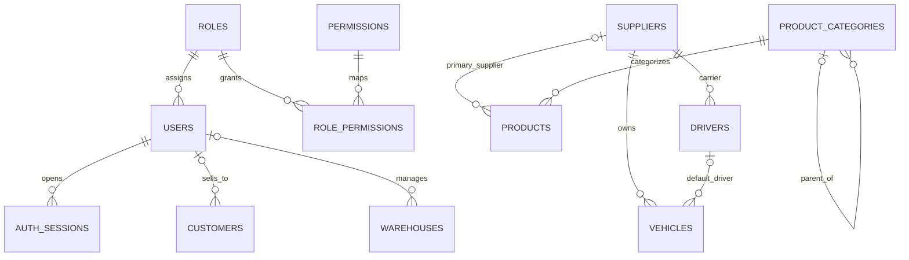
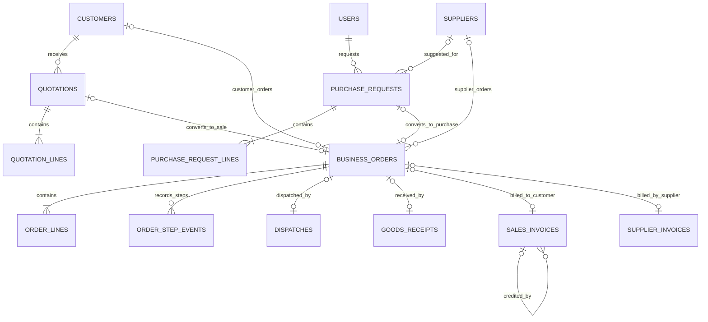
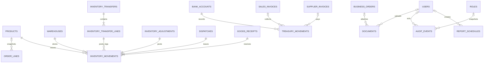

# Propuesta de diseño relacional para EnterpriseCloud

> Estado: propuesta para revisión. No se crearon tablas, no se ejecutó SQL, no se generaron migraciones y no se modificó `schema.prisma` ni código de aplicación.

## 1. Resumen del análisis

El frontend es una aplicación local-first: `src/data/store.ts` guarda casi todos los registros en `localStorage` bajo `ec-db-v1`, y `src/data/files.ts` almacena los blobs en IndexedDB. Las pantallas genéricas CRUD obtienen sus columnas, campos, reglas y colecciones de `src/pages/configs/*.ts`; cotizaciones, solicitudes, pedidos y sus efectos se implementan en `src/data/domain/flows.ts`, `orders.ts`, `stock.ts` y `finance.ts`.

El núcleo transaccional propuesto tiene **34 tablas**. Los pedidos de venta y compra se representan en una tabla común con tipo y una FK exclusiva al tercero correspondiente; cotizaciones y solicitudes conservan sus cabeceras y líneas antes de convertirse en pedido. El kardex es el registro de origen del stock físico. CxC, CxP, saldos, inventario disponible, estados de vencimiento, KPI y reportes se obtienen como vistas/consultas, no como saldos duplicados.

El frontend no tiene servicio REST conectado ni una base de datos real. Sus usuarios, datos de ejemplo, indicadores históricos, integración SUNAT, correo y algunos estados documentales son prototipos; la propuesta no trata esos mocks como hechos contables.

### Convenciones

- Todas las PK son `UUID`, salvo que una tabla use una PK compuesta indicada expresamente. UUID no sustituye los códigos de negocio visibles.
- `TIMESTAMPTZ` para instantes; `DATE` para vencimientos, fechas de emisión/entrega y vigencia que son fechas de negocio.
- Importes en `NUMERIC(14,2)`; precio unitario y costo unitario en `NUMERIC(14,6)` para conservar la precisión de las líneas del seed; cantidades/unidades en `NUMERIC(14,3)`.
- `NOT NULL` se indica `NN`; `NULL` indica opcional. Los defaults se anotan como `DEFAULT`. Los timestamps de creación/modificación normalmente llevan `DEFAULT now()`.
- Estados y categorías de flujo pueden ser `VARCHAR` con `CHECK` para facilitar evolución; no codificar etiquetas visuales traducidas como única regla de dominio.
- No se propone `tenant_id`: el frontend presenta una empresa. Si habrá multiempresa/multitenancy, debe resolverse antes del esquema físico.

## 2. Entidades y procedencia

| Entidad propuesta | Evidencia funcional del frontend |
|---|---|
| Usuarios, roles y permisos | `src/pages/configs/usuarios.ts`, `roles.ts`, `src/pages/PermisosPage.tsx`, `src/data/permissions.ts`, `src/data/domain/auth.ts` |
| Clientes y proveedores | `src/pages/configs/clientes.ts`, `proveedores.ts`; las cotizaciones, pedidos y finanzas los referencian en `src/data/domain/flows.ts` y `orders.ts` |
| Productos, categorías y almacenes | `productos.ts`, `categorias.ts`, `almacenes.ts`; reglas de SKU/costo/stock en `src/data/domain/stock.ts` |
| Conductores y vehículos | `conductores.ts`, `vehiculos.ts`; usados por el paso de despacho en `src/data/domain/orders.ts` |
| Cotizaciones y solicitudes | `src/pages/configs/cotizaciones.ts`, `solicitudes.ts`, `src/features/flowlist/FlowEditor.tsx`, `src/data/domain/flows.ts` |
| Pedidos de venta/compra y líneas | `src/data/types.ts`, `src/data/domain/orders.ts`, `src/features/order/NewOrderPage.tsx`, `OrderPage.tsx` |
| Despacho, recepción y comprobantes | pasos y efectos en `src/data/domain/orders.ts`; listas en `src/pages/configs/recepcion.ts`, `comprobantes.ts` |
| Inventario y transferencias | `src/pages/configs/stock.ts`, `kardex.ts`, `transferencias.ts`, `ajustes.ts`; `src/data/domain/stock.ts` |
| Tesorería y cuentas abiertas | `src/data/domain/finance.ts`; `src/pages/configs/caja.ts`, `bancos.ts`, `cuentasPorCobrar.ts`, `cuentasPorPagar.ts` |
| Documentos | `src/data/types.ts`, `src/data/files.ts`, `src/pages/DocumentosPage.tsx`, `src/data/domain/documents.ts` |
| Auditoría | `src/data/types.ts`, `src/data/domain/audit.ts`, `src/pages/AuditoriaPage.tsx` |
| Configuración y reportes | `src/data/settings.ts`, `src/pages/ConfiguracionPage.tsx`, `src/pages/ReportesPage.tsx`, `src/data/domain/metrics.ts` |

## 3. Qué persistir y qué derivar

### A. Persistencia relacional propuesta

Persistir maestros (clientes, proveedores, productos, categorías, almacenes, usuarios/roles), documentos de negocio editables (cotizaciones, solicitudes, pedidos), eventos operativos que cambian el stock, comprobantes propios y de proveedores, movimientos monetarios, metadata de archivos, configuración de empresa, sesiones y auditoría. Las líneas de documentos se conservan con snapshots de descripción/código/unidad/precio para que el historial no cambie al editar un maestro.

### B. Datos derivados; no guardar como fuente independiente

- `available = physical_stock - reserved_stock`; físico es la suma del kardex por producto/almacén. Con el flujo actual, reservado se calcula desde líneas de pedidos de venta confirmados aún no despachados ni anulados.
- Posición de inventario, saldo bancario/de caja, valor de stock, CxC/CxP pendiente y antigüedad: consultas/vistas sobre movimientos, comprobantes y vencimientos. No duplicar `saldo`, `dias`, `disponible`, `valor`, conteos ni estados de vencimiento.
- Subtotal, impuesto y total de pedidos: calcular desde cantidades, precio snapshot y tasa fijada al documento. Un comprobante fiscal emitido sí guarda sus importes definitivos como snapshot legal.
- Dashboard, alertas de stock/deuda/usuarios, ranking ABC, margen, rotación, aging, variaciones, KPIs, conteos y `stockStatus`: consultas sobre datos base.
- La historia `DB.history` (`salesByMonth`, `salesByClient`, `purchasesBySupplier`, `unitsSold90`) se crea para compensar los datos ficticios del demo, no son transacciones históricas. No importarla como ventas reales; los datos históricos reales requerirían un proyecto de migración explícito.
- Códigos secuenciales deben asignarse transaccionalmente con `document_sequences`, no copiando el objeto `counters` local ni calculándolos leyendo todas las filas.

### C. Solo frontend / temporal

Tema, densidad visual, búsqueda, filtros, paginación, selección, drawers/modales, pestaña activa, formularios aún no enviados, alertas leídas (`alertsRead`), `mode: demo/local`, blobs de IndexedDB, HTML imprimible y figuras de demo. La preferencia de tema vive incluso en `ec-theme`; no necesita tabla de negocio. El token de sesión actual solo guarda correo y hora en `localStorage/sessionStorage`; el backend debe emitir su propia sesión segura, nunca confiar en ese objeto del navegador.

## 4. Modelo relacional propuesto

Se proponen 34 tablas y una vista lógica `inventory_positions` (no una tabla). Salvo PK compuestas indicadas, cada tabla tiene `id UUID PK DEFAULT gen_random_uuid()`.

### Seguridad e identidad

#### 1. `roles`
- **Propósito:** perfiles de acceso asignables a usuarios.
- **Columnas:** `id UUID NN PK`; `code VARCHAR(40) NN UNIQUE`; `name VARCHAR(80) NN UNIQUE`; `description TEXT NULL`; `role_type VARCHAR(16) NN CHECK(system,custom)`; `is_active BOOLEAN NN DEFAULT true`; `created_at TIMESTAMPTZ NN DEFAULT now()`; `updated_at TIMESTAMPTZ NN`.
- **Relaciones/índices:** 1:N con `users`; N:M con `permissions` vía `role_permissions`. `UNIQUE(name)`.
- **Reglas:** los roles `Administrador`/`Gerente` aparecen como sistema; el frontend impide renombrar/eliminar roles de sistema o eliminar roles asignados. Conservar esos controles en backend.

#### 2. `permissions`
- **Propósito:** catálogo de acciones por módulo; evidencia: acciones `Ver`, `Crear`, `Editar`, `Eliminar`, `Aprobar` en `src/data/permissions.ts`.
- **Columnas:** `id UUID NN PK`; `module_key VARCHAR(80) NN`; `action_key VARCHAR(16) NN CHECK(view,create,edit,delete,approve)`; `UNIQUE(module_key, action_key)`.
- **Relaciones/índices:** N:M con `roles` vía `role_permissions`.
- **Reglas:** sembrar módulos basados en `MODULES`; decidir política de módulos desconocidos. La regla actual permite acceso a roles sin matriz, lo cual no debe trasladarse como default de seguridad.

#### 3. `role_permissions`
- **Propósito:** matriz normalizada rol-módulo-acción.
- **Columnas:** `role_id UUID NN FK -> roles.id`; `permission_id UUID NN FK -> permissions.id`; `granted BOOLEAN NN DEFAULT false`; `updated_at TIMESTAMPTZ NN DEFAULT now()`; **PK compuesta** `(role_id, permission_id)`.
- **Relaciones/índices:** tabla puente N:M; índice por `permission_id`.
- **Reglas:** toda acción distinta de `Ver` debe implicar `Ver`; quitar `Ver` quita las demás. El rol administrador se mantiene inmutable en la política de autorización.

#### 4. `users`
- **Propósito:** cuentas corporativas y estado de acceso.
- **Columnas:** `id UUID NN PK`; `role_id UUID NN FK -> roles.id`; `full_name VARCHAR(160) NN`; `email VARCHAR(254) NN`; `password_hash TEXT NULL`; `area VARCHAR(60) NULL`; `status VARCHAR(20) NN CHECK(invited,active,locked,inactive) DEFAULT 'invited'`; `mfa_enabled BOOLEAN NN DEFAULT false`; `failed_login_attempts SMALLINT NN DEFAULT 0`; `locked_until TIMESTAMPTZ NULL`; `last_login_at TIMESTAMPTZ NULL`; `created_at TIMESTAMPTZ NN DEFAULT now()`; `updated_at TIMESTAMPTZ NN`.
- **Relaciones/índices:** N:1 `roles`; 1:N `auth_sessions`; referencias opcionales desde documentos operativos/auditoría. `UNIQUE(lower(email))`; índice `(role_id,status)`.
- **Reglas:** normalizar correo a minúsculas. `password_hash` contiene solo hash seguro generado en backend (Argon2id recomendado), jamás contraseña; usuarios federados/invitados pueden no tener hash local. No reutilizar `demo1234` ni el SHA-256 local del prototipo. El MFA actual solo almacena un toggle, no implementa enrollment/challenge.

#### 5. `auth_sessions`
- **Propósito:** recordar duración, revocación y “mantener sesión” del login existente.
- **Columnas:** `id UUID NN PK`; `user_id UUID NN FK -> users.id`; `token_hash TEXT NN UNIQUE`; `persistent BOOLEAN NN DEFAULT true`; `issued_at TIMESTAMPTZ NN DEFAULT now()`; `last_seen_at TIMESTAMPTZ NULL`; `expires_at TIMESTAMPTZ NN`; `revoked_at TIMESTAMPTZ NULL`; `ip INET NULL`; `user_agent TEXT NULL`.
- **Relaciones/índices:** N:1 usuario; índice `(user_id, revoked_at, expires_at)`.
- **Reglas:** persistir hash del refresh/session token, nunca bearer token. Duración por política de seguridad; invalidar en logout, bloqueo o desactivación. Alternativa stateless requiere una decisión explícita sobre revocación.

### Mantenimiento

#### 6. `customers`
- **Propósito:** clientes usados por cotización, pedido, factura y cobranza.
- **Columnas:** `id UUID NN PK`; `code VARCHAR(20) NN UNIQUE`; `legal_name VARCHAR(200) NN`; `document_type VARCHAR(8) NN CHECK(RUC,DNI,CE)`; `document_number VARCHAR(24) NN`; `contact_name VARCHAR(160) NULL`; `phone VARCHAR(40) NULL`; `billing_email VARCHAR(254) NULL`; `fiscal_address TEXT NULL`; `payment_terms_days SMALLINT NN DEFAULT 0`; `credit_limit NUMERIC(14,2) NN DEFAULT 0`; `salesperson_user_id UUID NULL FK -> users.id`; `status VARCHAR(12) NN CHECK(active,inactive) DEFAULT 'active'`; `created_at TIMESTAMPTZ NN DEFAULT now()`; `updated_at TIMESTAMPTZ NN`.
- **Índices/relaciones:** `UNIQUE(document_type,document_number)` si la decisión fiscal confirma unicidad; índice por `status`, `salesperson_user_id`. 1:N con cotizaciones y ventas.
- **Reglas:** preservar clientes referenciados; desactivar en vez de borrar. Snapshot de nombre/documento/dirección en pedidos/comprobantes.

#### 7. `suppliers`
- **Propósito:** proveedor comercial y proveedor transportista.
- **Columnas:** `id UUID NN PK`; `code VARCHAR(20) NN UNIQUE`; `legal_name VARCHAR(200) NN`; `tax_id VARCHAR(24) NN UNIQUE`; `contact_name VARCHAR(160) NULL`; `phone VARCHAR(40) NULL`; `email VARCHAR(254) NULL`; `address TEXT NULL`; `business_category VARCHAR(80) NULL`; `payment_terms_days SMALLINT NN DEFAULT 0`; `bank_details_label TEXT NULL`; `status VARCHAR(12) NN CHECK(active,inactive) DEFAULT 'active'`; `created_at TIMESTAMPTZ NN DEFAULT now()`; `updated_at TIMESTAMPTZ NN`.
- **Índices/relaciones:** 1:N con órdenes de compra, solicitudes sugeridas, facturas proveedor, conductores/vehículos transportistas, productos como proveedor principal.
- **Reglas:** `bank_details_label` representa el texto libre actual (“Banco y número”), no una cuenta propia de la empresa. Desactivar si tiene historial.

#### 8. `product_categories`
- **Propósito:** catálogo jerárquico con descripción y margen objetivo.
- **Columnas:** `id UUID NN PK`; `code VARCHAR(20) NN UNIQUE`; `name VARCHAR(120) NN UNIQUE`; `description TEXT NULL`; `parent_category_id UUID NULL FK -> product_categories.id`; `target_margin_pct NUMERIC(5,2) NULL CHECK(0..100)`; `status VARCHAR(12) NN CHECK(active,inactive) DEFAULT 'active'`.
- **Relaciones/índices:** categoría 1:N productos y 1:N subcategorías; índice por `parent_category_id`.
- **Reglas:** impedir borrado mientras tenga productos/subcategorías; el padre actualmente se guarda como nombre y debe migrar a FK.

#### 9. `products`
- **Propósito:** catálogo con precios y parámetros de reposición.
- **Columnas:** `id UUID NN PK`; `sku VARCHAR(64) NN UNIQUE`; `name VARCHAR(200) NN`; `category_id UUID NULL FK -> product_categories.id`; `unit VARCHAR(24) NN`; `sale_price NUMERIC(14,6) NN CHECK(>=0)`; `average_cost NUMERIC(14,6) NN DEFAULT 0 CHECK(>=0)`; `minimum_stock NUMERIC(14,3) NN DEFAULT 0 CHECK(>=0)`; `primary_supplier_id UUID NULL FK -> suppliers.id`; `taxable BOOLEAN NN DEFAULT true`; `status VARCHAR(12) NN CHECK(active,inactive) DEFAULT 'active'`; `created_at TIMESTAMPTZ NN DEFAULT now()`; `updated_at TIMESTAMPTZ NN`.
- **Relaciones/índices:** N:1 categoría/proveedor; 1:N líneas y posiciones/movimientos de inventario. Índice `(category_id,status)`.
- **Reglas:** SKU no cambia si hay historial; conservar snapshots en líneas. El costo promedio móvil se actualiza en recepciones, dentro de la misma transacción que mueve stock; decidir si se permite edición manual, pues el formulario actual sí muestra costo editable.

#### 10. `warehouses`
- **Propósito:** ubicaciones físicas/virtuales y almacén de tránsito.
- **Columnas:** `id UUID NN PK`; `code VARCHAR(20) NN UNIQUE`; `name VARCHAR(120) NN UNIQUE`; `warehouse_type VARCHAR(16) NN CHECK(main,secondary,transit)`; `address TEXT NULL`; `district VARCHAR(100) NULL`; `manager_user_id UUID NULL FK -> users.id`; `status VARCHAR(12) NN CHECK(active,inactive) DEFAULT 'active'`; timestamps.
- **Relaciones/índices:** 1:N con movimientos, transferencias, pedidos, recepciones y ajustes; índice por `status`.
- **Reglas:** no borrar si tiene saldo no nulo o historial; cambiar a inactivo. Si cambia el nombre, la FK conserva identidad.

#### 11. `drivers`
- **Propósito:** conductores propios y de transportistas.
- **Columnas:** `id UUID NN PK`; `code VARCHAR(20) NN UNIQUE`; `full_name VARCHAR(160) NN`; `national_id VARCHAR(24) NN UNIQUE`; `phone VARCHAR(40) NULL`; `license_number VARCHAR(40) NN UNIQUE`; `license_category VARCHAR(16) NN`; `is_company_driver BOOLEAN NN DEFAULT true`; `carrier_supplier_id UUID NULL FK -> suppliers.id`; `status VARCHAR(12) NN CHECK(active,inactive) DEFAULT 'active'`.
- **Relaciones/índices:** N:1 proveedor transportista opcional; 1:N despachos y vehículos como conductor habitual.
- **Reglas:** proveedor requerido si no es conductor propio; no borrar si aparece en despachos.

#### 12. `vehicles`
- **Propósito:** flota y transportes asociados a despachos.
- **Columnas:** `id UUID NN PK`; `plate VARCHAR(16) NN UNIQUE`; `vehicle_type VARCHAR(32) NN`; `brand VARCHAR(80) NULL`; `model VARCHAR(80) NULL`; `capacity NUMERIC(12,3) NULL`; `capacity_unit VARCHAR(12) NULL`; `is_company_vehicle BOOLEAN NN DEFAULT true`; `carrier_supplier_id UUID NULL FK -> suppliers.id`; `default_driver_id UUID NULL FK -> drivers.id`; `status VARCHAR(12) NN CHECK(active,inactive) DEFAULT 'active'`.
- **Índices/relaciones:** N:1 proveedor/conductor; 1:N despachos; índice por estado.
- **Reglas:** proveedor obligatorio si es vehículo de terceros; validar conductor compatible con el transportista al despachar. La UI hoy captura capacidad como texto como “10 Tn”; unidad debe normalizarse.

### Ventas y compras

#### 13. `quotations`
- **Propósito:** propuesta comercial antes del pedido.
- **Columnas:** `id UUID NN PK`; `code VARCHAR(24) NN UNIQUE`; `customer_id UUID NN FK -> customers.id`; `seller_user_id UUID NULL FK -> users.id`; `created_at TIMESTAMPTZ NN DEFAULT now()`; `valid_until DATE NULL`; `payment_terms_days SMALLINT NN DEFAULT 0`; `warehouse_id UUID NULL FK -> warehouses.id`; `accepted_contact_snapshot VARCHAR(160) NULL`; `status VARCHAR(16) NN CHECK(draft,sent,approved,converted,rejected) DEFAULT 'draft'`; `rejected_reason TEXT NULL`; `updated_at TIMESTAMPTZ NN`.
- **Relaciones/índices:** 1:N `quotation_lines`; 0..1 pedido de venta originado (FK desde `business_orders.quotation_id`); índice `(customer_id,created_at)` y `(status,valid_until)`.
- **Reglas:** una cotización convertida no se edita; la conversión crea pedido preservando cliente, líneas y precio. Una venta directa puede no tener cotización.

#### 14. `quotation_lines`
- **Propósito:** productos/precios cotizados antes de conversión.
- **Columnas:** `id UUID NN PK`; `quotation_id UUID NN FK -> quotations.id`; `line_no SMALLINT NN`; `product_id UUID NULL FK -> products.id`; `sku_snapshot VARCHAR(64) NN`; `name_snapshot VARCHAR(200) NN`; `unit_snapshot VARCHAR(24) NN`; `quantity NUMERIC(14,3) NN CHECK(>0)`; `unit_price NUMERIC(14,6) NN CHECK(>=0)`; `created_at TIMESTAMPTZ NN DEFAULT now()`.
- **Índices/relaciones:** `UNIQUE(quotation_id,line_no)`; índice por `product_id`; cabecera 1:N líneas.
- **Reglas:** prohibir SKU repetido en una misma cotización según `linesError`; precio no incluye IGV conforme al editor.

#### 15. `purchase_requests`
- **Propósito:** solicitud interna previa a una OC.
- **Columnas:** `id UUID NN PK`; `code VARCHAR(24) NN UNIQUE`; `requested_by_user_id UUID NN FK -> users.id`; `requesting_area VARCHAR(60) NN`; `reason TEXT NN`; `priority VARCHAR(8) NN CHECK(high,medium,low)`; `required_by DATE NULL`; `warehouse_id UUID NULL FK -> warehouses.id`; `suggested_supplier_id UUID NULL FK -> suppliers.id`; `status VARCHAR(16) NN CHECK(pending,approved,attended,rejected) DEFAULT 'pending'`; `reviewed_by_user_id UUID NULL FK -> users.id`; `reviewed_at TIMESTAMPTZ NULL`; `rejection_reason TEXT NULL`; timestamps.
- **Relaciones/índices:** 1:N `purchase_request_lines`; 0..1 OC derivada por `business_orders.purchase_request_id`; índice `(status,required_by)`.
- **Reglas:** aprobación la realiza rol autorizado; una solicitud atendida ya tiene orden asociada. El formulario exige motivo y admite proveedor sugerido opcional.

#### 16. `purchase_request_lines`
- **Propósito:** artículos/costos estimados solicitados.
- **Columnas:** `id UUID NN PK`; `purchase_request_id UUID NN FK -> purchase_requests.id`; `line_no SMALLINT NN`; `product_id UUID NULL FK -> products.id`; `name_snapshot VARCHAR(200) NN`; `sku_snapshot VARCHAR(64) NULL`; `unit_snapshot VARCHAR(24) NN`; `quantity NUMERIC(14,3) NN CHECK(>0)`; `estimated_unit_cost NUMERIC(14,6) NN CHECK(>=0)`.
- **Índices/relaciones:** `UNIQUE(purchase_request_id,line_no)`; producto opcional porque existe solicitud de un artículo fuera del catálogo en datos demo.
- **Reglas:** líneas no vacías, cantidades positivas, SKU sin duplicados. Convertir copia las líneas a `order_lines`.

#### 17. `business_orders`
- **Propósito:** cabecera compartida de órdenes de venta y compra, reflejando la interfaz de un mismo `Order` con `kind`.
- **Columnas:** `id UUID NN PK`; `code VARCHAR(24) NN UNIQUE`; `kind VARCHAR(8) NN CHECK(sale,purchase)`; `customer_id UUID NULL FK -> customers.id`; `supplier_id UUID NULL FK -> suppliers.id`; `quotation_id UUID NULL UNIQUE FK -> quotations.id`; `purchase_request_id UUID NULL UNIQUE FK -> purchase_requests.id`; `warehouse_id UUID NN FK -> warehouses.id`; `seller_user_id UUID NULL FK -> users.id`; `created_by_user_id UUID NULL FK -> users.id`; snapshots `party_name`, `party_tax_id`, `party_address`, `party_contact`, `party_email` (`VARCHAR/TEXT NULL` salvo nombre NN); `payment_terms_days SMALLINT NN DEFAULT 0`; `tax_rate NUMERIC(5,4) NN`; `current_step SMALLINT NN DEFAULT 1 CHECK(1..5)`; `is_cancelled BOOLEAN NN DEFAULT false`; `cancelled_at TIMESTAMPTZ NULL`; `cancelled_by_user_id UUID NULL FK -> users.id`; `created_at TIMESTAMPTZ NN DEFAULT now()`; `updated_at TIMESTAMPTZ NN`.
- **Relaciones/índices:** 1:N `order_lines`, `order_step_events`; 0..1 `dispatches`, `goods_receipts`, `sales_invoices` o `supplier_invoices` en el flujo actual. Índice `(kind,created_at)`, `(customer_id,created_at)`, `(supplier_id,created_at)`, `(warehouse_id,current_step)`.
- **Restricciones/reglas:** CHECK exactamente uno de `customer_id`/`supplier_id`, concordante con `kind`; solo una de `quotation_id`/`purchase_request_id`, concordante con tipo; no permitir ambas. Snapshot del tercero conserva historia cuando el maestro cambia. No duplicar `total` ni etiquetas de estado derivables de `current_step` y cancelación. Anulación solo antes de despacho; en venta confirmada debe liberar la reserva.

#### 18. `order_lines`
- **Propósito:** detalle económico de una orden.
- **Columnas:** `id UUID NN PK`; `order_id UUID NN FK -> business_orders.id`; `line_no SMALLINT NN`; `product_id UUID NULL FK -> products.id`; `sku_snapshot VARCHAR(64) NN`; `name_snapshot VARCHAR(200) NN`; `unit_snapshot VARCHAR(24) NN`; `quantity NUMERIC(14,3) NN CHECK(>0)`; `unit_price NUMERIC(14,6) NN CHECK(>=0)`; `created_at TIMESTAMPTZ NN DEFAULT now()`.
- **Índices/relaciones:** `UNIQUE(order_id,line_no)`; índice `(product_id,order_id)`.
- **Reglas:** impedir SKU duplicado por orden. Para venta, `unit_price` es precio antes de IGV; para compra, costo pactado. Mantener snapshots en vez de leer valores históricos del producto actual.

#### 19. `order_step_events`
- **Propósito:** historial mínimo de quién completó cada uno de los cinco hitos.
- **Columnas:** `id UUID NN PK`; `order_id UUID NN FK -> business_orders.id`; `step_no SMALLINT NN CHECK(1..5)`; `completed_by_user_id UUID NULL FK -> users.id`; `completed_at TIMESTAMPTZ NN`; `generated_reference VARCHAR(80) NULL`; `note TEXT NULL`.
- **Índices/relaciones:** `UNIQUE(order_id,step_no)`; index `(completed_by_user_id,completed_at)`.
- **Reglas:** inmutable después de creado; no guardar los formularios arbitrarios `forms: Record<number,Record<string,string>>` como JSON opaco. Los campos relevantes viven en despacho, recepción, comprobantes y tesorería. Un cobro parcial es un movimiento independiente aunque el hito siga abierto.

#### 20. `dispatches`
- **Propósito:** datos del despacho y guía, paso venta 3.
- **Columnas:** `id UUID NN PK`; `order_id UUID NN UNIQUE FK -> business_orders.id`; `dispatch_number VARCHAR(40) NN UNIQUE`; `dispatched_at TIMESTAMPTZ NN`; `reason VARCHAR(40) NN`; `carrier_supplier_id UUID NULL FK -> suppliers.id`; `vehicle_id UUID NULL FK -> vehicles.id`; `driver_id UUID NULL FK -> drivers.id`; `warehouse_id UUID NN FK -> warehouses.id`; `destination_snapshot TEXT NN`; `created_by_user_id UUID NULL FK -> users.id`; `created_at TIMESTAMPTZ NN DEFAULT now()`.
- **Índices/relaciones:** 1:1 con pedido de venta; 1:N movimientos de inventario; opcional 1:N documentos metadata relacionados.
- **Reglas:** registrar salida por cada línea de orden en la misma transacción; vehículo/conductor solo si se conocen, ya que el frontend permite texto manual cuando no están en catálogo.

#### 21. `goods_receipts`
- **Propósito:** recepción de OC y nota de ingreso, paso compra 3.
- **Columnas:** `id UUID NN PK`; `order_id UUID NN UNIQUE FK -> business_orders.id`; `receipt_number VARCHAR(40) NN UNIQUE`; `received_at TIMESTAMPTZ NN`; `supplier_guide_reference VARCHAR(80) NULL`; `warehouse_id UUID NN FK -> warehouses.id`; `condition VARCHAR(20) NN CHECK(conforming,observations)`; `observations TEXT NULL`; `received_by_user_id UUID NULL FK -> users.id`; `created_at TIMESTAMPTZ NN DEFAULT now()`.
- **Índices/relaciones:** 1:1 con pedido de compra en el flujo actual; 1:N movimientos del kardex.
- **Reglas:** la UI actual registra recepción completa del pedido en un único paso; recepción parcial/múltiple queda pendiente. Guardar y crear movimientos/actualizar costo promedio atómicamente.

#### 22. `sales_invoices`
- **Propósito:** factura, boleta o nota de crédito propia emitida desde venta.
- **Columnas:** `id UUID NN PK`; `order_id UUID NN UNIQUE FK -> business_orders.id`; `customer_id UUID NN FK -> customers.id`; `original_invoice_id UUID NULL FK -> sales_invoices.id`; `document_type VARCHAR(20) NN CHECK(invoice,receipt,credit_note)`; `series VARCHAR(12) NN`; `number VARCHAR(24) NN`; `issued_at DATE NN`; `due_at DATE NULL`; `currency CHAR(3) NN DEFAULT 'PEN'`; `subtotal NUMERIC(14,2) NN`; `tax_amount NUMERIC(14,2) NN`; `total NUMERIC(14,2) NN`; `tax_status VARCHAR(16) NN CHECK(pending,accepted,rejected,voided)`; `void_reason TEXT NULL`; `created_at TIMESTAMPTZ NN DEFAULT now()`.
- **Índices/relaciones:** `UNIQUE(series,number)`; FK a pedido/cliente; nota de crédito N:1 comprobante original; índice `(customer_id,due_at)` y `(tax_status,issued_at)`.
- **Reglas:** importe fiscal emitido es snapshot. Notas de crédito llevan total negativo o ajuste firmado y FK a original; calcular deuda considerando nota de crédito. El frontend simula SUNAT; no asumir que estado `Aceptado` constituye respuesta real.

#### 23. `supplier_invoices`
- **Propósito:** factura recibida del proveedor que genera la obligación por pagar.
- **Columnas:** `id UUID NN PK`; `order_id UUID NN UNIQUE FK -> business_orders.id`; `supplier_id UUID NN FK -> suppliers.id`; `series_number VARCHAR(40) NN`; `issued_at DATE NN`; `due_at DATE NN`; `currency CHAR(3) NN DEFAULT 'PEN'`; `total NUMERIC(14,2) NN CHECK(>0)`; `validation_status VARCHAR(20) NN CHECK(matches_order_receipt,has_differences)`; `created_by_user_id UUID NULL FK -> users.id`; `created_at TIMESTAMPTZ NN DEFAULT now()`.
- **Índices/relaciones:** `UNIQUE(supplier_id,series_number)`; N:1 pedido/proveedor; 1:N movimientos de pago.
- **Reglas:** la validación de 3 vías OC-recepción-factura se muestra en UI, pero no hay tratamiento real de diferencias. No crear un segundo comprobante SUNAT para proveedor.

### Inventario

#### 24. `inventory_transfers`
- **Propósito:** cabecera del traslado entre almacenes.
- **Columnas:** `id UUID NN PK`; `code VARCHAR(24) NN UNIQUE`; `created_at TIMESTAMPTZ NN`; `source_warehouse_id UUID NN FK -> warehouses.id`; `destination_warehouse_id UUID NN FK -> warehouses.id`; `responsible_user_id UUID NULL FK -> users.id`; `status VARCHAR(16) NN CHECK(pending,in_transit,received,cancelled)`; `dispatched_at TIMESTAMPTZ NULL`; `received_at TIMESTAMPTZ NULL`; `updated_at TIMESTAMPTZ NN`.
- **Relaciones/índices:** 1:N `inventory_transfer_lines`; índice `(status,created_at)`.
- **Reglas:** almacenes origen/destino distintos. Salida al despachar, entrada al confirmar recepción; no sumar destino antes de recibir.

#### 25. `inventory_transfer_lines`
- **Propósito:** productos y cantidades de la transferencia.
- **Columnas:** `id UUID NN PK`; `transfer_id UUID NN FK -> inventory_transfers.id`; `line_no SMALLINT NN`; `product_id UUID NN FK -> products.id`; `sku_snapshot VARCHAR(64) NN`; `name_snapshot VARCHAR(200) NN`; `unit_snapshot VARCHAR(24) NN`; `quantity NUMERIC(14,3) NN CHECK(>0)`.
- **Índices/relaciones:** `UNIQUE(transfer_id,line_no)`; FK producto; 1:N movimientos de salida/entrada.
- **Reglas:** cantidad y producto obligatorios; el frontend tiene filas demo multproducto, pero el formulario actual crea solo un producto por transferencia.

#### 26. `inventory_adjustments`
- **Propósito:** documento inmutable de ajuste por merma, sobrante, vencimiento o corrección.
- **Columnas:** `id UUID NN PK`; `code VARCHAR(24) NN UNIQUE`; `product_id UUID NN FK -> products.id`; `warehouse_id UUID NN FK -> warehouses.id`; `adjustment_type VARCHAR(16) NN CHECK(loss,surplus,expiry,correction)`; `reason TEXT NN`; `created_by_user_id UUID NULL FK -> users.id`; `created_at TIMESTAMPTZ NN DEFAULT now()`.
- **Relaciones/índices:** 1:1 con movimiento del kardex generado; índice `(product_id,warehouse_id,created_at)`.
- **Reglas:** cantidad firmada se conserva en el movimiento, no duplicada aquí; sobrante suma y los demás tipos restan según UI. No editar/borrar una vez contabilizado; corregir con un nuevo ajuste.

#### 27. `inventory_movements`
- **Propósito:** kardex inmutable y fuente de verdad del stock físico.
- **Columnas:** `id UUID NN PK`; `occurred_at TIMESTAMPTZ NN`; `product_id UUID NN FK -> products.id`; `warehouse_id UUID NN FK -> warehouses.id`; `movement_type VARCHAR(16) NN CHECK(receipt,dispatch,transfer,adjustment)`; `quantity_delta NUMERIC(14,3) NN CHECK(<>0)`; `unit_cost NUMERIC(14,6) NN CHECK(>=0)`; `order_line_id UUID NULL FK -> order_lines.id`; `dispatch_id UUID NULL FK -> dispatches.id`; `goods_receipt_id UUID NULL FK -> goods_receipts.id`; `transfer_line_id UUID NULL FK -> inventory_transfer_lines.id`; `adjustment_id UUID NULL FK -> inventory_adjustments.id`; `movement_leg VARCHAR(8) NULL CHECK(out,in)`; `reference_snapshot VARCHAR(80) NN`; `created_by_user_id UUID NULL FK -> users.id`; `created_at TIMESTAMPTZ NN DEFAULT now()`.
- **Índices/relaciones:** índice `(product_id,warehouse_id,occurred_at,id)` para kardex/saldo; `(warehouse_id,occurred_at)`; índices en cada FK de origen.
- **Restricciones/reglas:** exactamente un origen operativo (recepción, despacho, transferencia o ajuste); `movement_leg` solo para transferencia. Transferencia crea dos movimientos por línea con misma referencia. Prohibir editar/eliminar y contabilizar documentos + movimientos en una sola transacción. `saldo` mostrado en UI se deriva con suma acumulada ordenada por `occurred_at,id`; no persistir el saldo repetido.

#### Vista `inventory_positions` (no tabla)
- Agrupa `inventory_movements` por producto y almacén para `physical_qty`; resta órdenes de venta en el único estado que mantiene reserva (`current_step = 2`, sin anulación/despacho) para `reserved_qty`; calcula `available_qty = physical_qty - reserved_qty`, valor y estado respecto al mínimo del producto. Requiere revisar índices/consultas con volúmenes reales.

### Finanzas

#### 28. `bank_accounts`
- **Propósito:** cuentas propias elegibles para cobros/pagos; hoy son strings dentro de `settings.cuentas` y de aperturas.
- **Columnas:** `id UUID NN PK`; `label VARCHAR(120) NN UNIQUE`; `bank_name VARCHAR(80) NULL`; `account_reference VARCHAR(80) NULL`; `currency CHAR(3) NN DEFAULT 'PEN'`; `opening_balance NUMERIC(14,2) NN DEFAULT 0`; `opening_as_of DATE NULL`; `is_active BOOLEAN NN DEFAULT true`; timestamps.
- **Relaciones/índices:** 1:N movimientos de tesorería; índice `is_active`.
- **Reglas:** no confundir cuentas bancarias propias con el texto de cuenta bancaria de proveedor. Decidir enmascaramiento/cifrado de referencias bancarias.

#### 29. `treasury_movements`
- **Propósito:** ledger común que normaliza las listas actuales de Caja y Bancos, y también conserva cada cobro/pago parcial.
- **Columnas:** `id UUID NN PK`; `code VARCHAR(32) NN UNIQUE`; `occurred_at TIMESTAMPTZ NN`; `channel VARCHAR(8) NN CHECK(cash,bank)`; `movement_type VARCHAR(24) NN` (cobro, pago, apertura, comisión, ingreso/egreso manual, etc.); `signed_amount NUMERIC(14,2) NN CHECK(<>0)`; `description TEXT NN`; `payment_method VARCHAR(24) NULL`; `operation_reference VARCHAR(80) NULL`; `bank_account_id UUID NULL FK -> bank_accounts.id`; `sales_invoice_id UUID NULL FK -> sales_invoices.id`; `supplier_invoice_id UUID NULL FK -> supplier_invoices.id`; `reconciliation_status VARCHAR(12) NULL CHECK(pending,reconciled)`; `note TEXT NULL`; `created_by_user_id UUID NULL FK -> users.id`; `created_at TIMESTAMPTZ NN DEFAULT now()`.
- **Índices/relaciones:** índices `(occurred_at,channel)`, `(bank_account_id,occurred_at)`, `(sales_invoice_id,occurred_at)`, `(supplier_invoice_id,occurred_at)`.
- **Restricciones/reglas:** para `channel=bank`, cuenta bancaria requerida; para `cash`, no aplica cuenta. Como máximo uno de `sales_invoice_id`/`supplier_invoice_id`; movimiento de cobro positivo y de pago negativo. Ingreso reduce CxC; egreso reduce CxP. Apertura bancaria va en `bank_accounts`, apertura de caja como movimiento. No recalcular estados por strings almacenados.

#### 30. `company_settings`
- **Propósito:** una fila de parámetros globales de empresa que afectan documentos, impuestos y operaciones.
- **Columnas:** `id SMALLINT NN PK CHECK(id=1)`; `tax_id VARCHAR(24) NN`; `legal_name VARCHAR(200) NN`; `fiscal_address TEXT NULL`; `currency CHAR(3) NN DEFAULT 'PEN'`; `time_zone VARCHAR(64) NN DEFAULT 'America/Lima'`; `invoice_series VARCHAR(12) NN`; `receipt_series VARCHAR(12) NN`; `dispatch_series VARCHAR(12) NN`; `credit_note_series VARCHAR(12) NN`; `auto_tax_submission BOOLEAN NN DEFAULT false`; `email_documents BOOLEAN NN DEFAULT false`; `tax_rate NUMERIC(5,4) NN DEFAULT 0.18`; `prices_include_tax BOOLEAN NN DEFAULT false`; `max_discount_pct NUMERIC(5,2) NN`; `quotation_validity_days SMALLINT NN`; `cost_method VARCHAR(24) NN CHECK(weighted_average)`; `default_warehouse_id UUID NULL FK -> warehouses.id`; `allow_negative_stock BOOLEAN NN DEFAULT false`; `reorder_alerts_enabled BOOLEAN NN DEFAULT true`; `session_duration_hours SMALLINT NN`; `max_login_attempts SMALLINT NN`; `mfa_required BOOLEAN NN DEFAULT false`; `audit_retention_years SMALLINT NN`; `updated_at TIMESTAMPTZ NN`.
- **Relaciones/índices:** almacén predeterminado opcional; singleton por `id=1`.
- **Reglas:** excluir tema/densidad (preferencias de navegador). No colocar secretos SUNAT/correo aquí; usar secret manager/env. RUC y razón social deben snapshotearse en comprobantes.

### Documentación, auditoría y soporte

#### 31. `documents`
- **Propósito:** metadata del repositorio documental, no el contenido binario.
- **Columnas:** `id UUID NN PK`; `name VARCHAR(255) NN`; `category VARCHAR(32) NN CHECK(invoice,contract,purchase_order,dispatch_guide,other,attachment)`; `storage_key TEXT NULL`; `mime_type VARCHAR(120) NULL`; `byte_size BIGINT NULL CHECK(>=0)`; `version_label VARCHAR(40) NN`; `related_order_id UUID NULL FK -> business_orders.id`; `related_customer_id UUID NULL FK -> customers.id`; `related_supplier_id UUID NULL FK -> suppliers.id`; `uploaded_by_user_id UUID NULL FK -> users.id`; `created_at TIMESTAMPTZ NN DEFAULT now()`; `deleted_at TIMESTAMPTZ NULL`.
- **Índices/relaciones:** FK opcional a orden/cliente/proveedor, máximo una relación principal; índices `(category,created_at)`, cada FK y `storage_key` unique si no null.
- **Reglas:** PDF/XML/adjuntos van a Supabase Storage u otro object storage con key privada; no columnas `BYTEA`, HTML ni `blobKey` de IndexedDB. HTML imprimible se regenera desde transacción. La política de descarga debe usar permisos backend/storage, no la lista visual `ROLES` constante.

#### 32. `audit_events`
- **Propósito:** bitácora append-only de accesos, CRUD, exportaciones, descargas y denegaciones.
- **Columnas:** `id UUID NN PK`; `occurred_at TIMESTAMPTZ NN DEFAULT now()`; `user_id UUID NULL FK -> users.id`; `role_id UUID NULL FK -> roles.id`; `user_name_snapshot VARCHAR(160) NN`; `role_name_snapshot VARCHAR(80) NULL`; `action VARCHAR(16) NN CHECK(login,create,edit,delete,export,download)`; `module_key VARCHAR(80) NN`; `entity_type VARCHAR(80) NULL`; `entity_id UUID NULL`; `reference_snapshot VARCHAR(120) NULL`; `description TEXT NN`; `result VARCHAR(12) NN CHECK(success,failure,denied)`; `changes JSONB NN DEFAULT []`; `detail TEXT NULL`; `ip INET NULL`; `device TEXT NULL`; `request_id UUID NULL`.
- **Índices/relaciones:** `(occurred_at DESC)`, `(user_id,occurred_at DESC)`, `(module_key,occurred_at DESC)`, `(entity_type,entity_id)`; FK opcionales a usuario/rol.
- **Reglas:** append-only para el rol de aplicación; excluir hashes, contraseñas y tokens de `changes/detail`; `entity_id` polimórfico no puede usar FK universal, por eso conservar también tipo y referencia snapshot. IP solo desde proxy confiable. Retención configurable con auditoría/retención legal.

#### 33. `report_schedules`
- **Propósito:** configuración de envíos programados que el frontend actualmente solo registra.
- **Columnas:** `id UUID NN PK`; `report_key VARCHAR(80) NN`; `recipient_email VARCHAR(254) NN`; `frequency VARCHAR(12) NN CHECK(daily,weekly,monthly)`; `is_enabled BOOLEAN NN DEFAULT true`; `created_by_user_id UUID NULL FK -> users.id`; timestamps.
- **Índices/relaciones:** `UNIQUE(report_key)` replica un único schedule vigente por reporte; índice `(is_enabled,frequency)`.
- **Reglas:** el frontend dice expresamente que no envía correo. No crear colas/ejecuciones hasta aprobar requerimientos de zona horaria, fallos y destinatarios múltiples.

#### 34. `document_sequences`
- **Propósito:** generar de forma segura códigos `CLI`, `OV`, `OC`, `COT`, `SOL`, `TRF`, `AJ`, guías, facturas, cobros y pagos con concurrencia.
- **Columnas:** `document_type VARCHAR(32) NN`; `fiscal_year SMALLINT NN`; `series VARCHAR(12) NN DEFAULT ''`; `last_value BIGINT NN DEFAULT 0 CHECK(>=0)`; `updated_at TIMESTAMPTZ NN`; **PK compuesta** `(document_type,fiscal_year,series)`.
- **Relaciones/índices:** índice por `document_type,fiscal_year`.
- **Reglas:** reservar/incrementar en la misma transacción que inserta el documento; además mantener `UNIQUE` en el código/serie final de las tablas correspondientes. No aceptar el contador enviado por el frontend.

## 5. Relaciones y cardinalidades

- **1:N:** `roles -> users`; `quotations -> quotation_lines`; `purchase_requests -> purchase_request_lines`; `business_orders -> order_lines/order_step_events`; `product_categories -> products`; `products/warehouses -> inventory_movements`; `bank_accounts -> treasury_movements`; usuario -> sesiones/auditoría.
- **1:1 en el flujo actual:** venta -> despacho -> factura; compra -> recepción -> factura de proveedor, con `UNIQUE(order_id)`. La interfaz solo avanza cada uno de esos pasos una vez.
- **N:M:** `roles <-> permissions` mediante `role_permissions`; transferencias <-> productos mediante `inventory_transfer_lines` (con cantidad); auditoría no implementa join de entidad por su naturaleza cross-module.
- **Opcionales:** un tercero tiene vendedor/proveedor principal, conductor transportista, vehículo conductor habitual y documento relacionado con una orden/cliente/proveedor.
- **Origen de orden:** cotización aprobada 0..1 -> pedido venta; solicitud aprobada 0..1 -> pedido compra; una orden directa no tiene documento origen.

## 6. Restricciones e índices transversales

- Códigos comerciales, SKU, placa, correo normalizado, documentos tributarios y número de comprobante con unicidad acorde a ámbito/serie.
- Cantidades de línea positivas, importes de documento no nulos y denominadores/porcentajes dentro de rango; movimiento de stock con cantidad firmada distinta de cero; ledger de caja/banco con importe firmado distinto de cero.
- CHECK de tercero exactamente uno para la orden, una única fuente de origen compatible con tipo, cuenta bancaria requerida solo para canal bancario, y origen único por movimiento de inventario.
- FKs históricas `RESTRICT` para clientes, proveedores, productos y almacenes ya referenciados. Para tablas puente puras (`role_permissions`, líneas de documentos borradores) puede usarse `CASCADE`; movimientos/auditoría no se borran en cascada.
- Índices temporales por fecha y compuestos alineados a filtros reales: pedido por tipo/fecha/cliente/proveedor, documentos por categoría/fecha, CxC/CxP por vencimiento, kardex por producto+almacén+fecha, auditoría por fecha/actor/módulo.
- Los estados de vencimiento, balances, valores de inventario, conteos de productos y alertas no necesitan índices propios hasta materializarse; medir primero consultas reales.

## 7. Reglas de negocio observadas

1. Venta: cotización opcional -> orden -> confirmación y reserva -> despacho/salida+guía -> comprobante -> cobranza. Venta directa omite cotización.
2. Compra: solicitud opcional -> orden/aprobación -> recepción/entrada+nota de ingreso -> factura proveedor -> pago. Compra directa omite solicitud.
3. Precio de línea no incluye IGV; pedido fija la tasa aplicada. Cotización actual usa 18% fijo, mientras orden lee la configuración de IGV.
4. Reserva de venta se crea al confirmar; se libera al despachar o anular antes del despacho. No hay reservas con kardex físico en el frontend.
5. Kardex registra entradas/salidas y ambos lados de transferencias; movimientos no editables/borrables. Ajuste correctivo es otro movimiento.
6. Costo medio ponderado se actualiza al recibir; costo del movimiento debe quedar como snapshot para poder reconstruir valoración histórica.
7. Cobros y pagos pueden ser parciales; cada operación tiene monto, fecha, medio, cuenta/caja y referencia. El saldo pendiente y vencimiento se derivan.
8. Comprobante rechazado puede reintentarse; anulación de comprobante genera nota de crédito y cancela el saldo asociado. SUNAT real no está integrado aún.
9. Maestros referenciados no se borran; se inactivan. Pedidos completados y kardex conservan datos incluso si cambia el maestro.
10. Permisos por rol y acción; cambios de configuración/permisos, exportaciones, descargas e intentos de login generan auditoría.

## 8. Datos que no se convierten en tablas

- Dashboard, informes, aging de cartera, ABC, rotación, margen, valor de inventario, tickets medios, estados de vencimiento y alertas son consultas derivadas.
- `history.*` de `seed.ts` y datos de `mock.ts` son agregados de diseño y no eventos transaccionales.
- `stock` actual en `records.stock` puede exponerse como vista; `stock.res`, `disp`, `estado`, `saldo` de kardex son derivados.
- Colecciones `cxc` y `cxp` no requieren duplicar invoice/due/total/saldo/estado: las vistas de cartera se forman desde factura - notas de crédito - movimientos de cobro/pago.
- `recepcion` y `ordenesDeCompra` en pantalla son transformaciones de orders; no duplicar esos listados como entidad adicional. La recepción real sí se persiste en `goods_receipts` como hito operativo.
- Tema, densidad, filtros, búsqueda, selección, páginas, estado de modal y contenido de formulario no enviado son estado de UI.
- Documentos de muestra sin archivos, HTML imprimible, tamaños humanizados, nombre de entidad repetido y roles de lectura hard-coded son representación/metadata derivable, no payload de base de datos.
- `counters`, `alertsRead`, `mode`, `bankOpening` como objeto y `reportSchedules` en el store se reemplazan por tablas o proyecciones indicadas; no se conserva el objeto JSON completo del store.

## 9. Diagrama ER Mermaid

### Seguridad y mantenimiento

### Pedidos y documentos comerciales

### Inventario, tesorería y soporte

## 10. Orden de creación de tablas

Orden topológico sugerido por FK; las tablas sin dependencia pueden crearse en paralelo dentro de una fase:

1. `roles`
2. `permissions`
3. `document_sequences`
4. `users`
5. `role_permissions`
6. `auth_sessions`
7. `suppliers`
8. `product_categories`
9. `warehouses`
10. `customers`
11. `drivers`
12. `vehicles`
13. `products`
14. `quotations`
15. `quotation_lines`
16. `purchase_requests`
17. `purchase_request_lines`
18. `business_orders`
19. `order_lines`
20. `order_step_events`
21. `dispatches`
22. `goods_receipts`
23. `sales_invoices`
24. `supplier_invoices`
25. `bank_accounts`
26. `treasury_movements`
27. `inventory_transfers`
28. `inventory_transfer_lines`
29. `inventory_adjustments`
30. `inventory_movements`
31. `documents`
32. `audit_events`
33. `report_schedules`
34. `company_settings`

Crear `inventory_positions` como vista después de sus fuentes. Las referencias circulares se evitan dejando `business_orders` referenciar cotización/solicitud, no a la inversa. En Prisma podrían modelarse relaciones opcionales con nombres distintos y validar el CHECK en migración.

## 11. Preguntas / decisiones pendientes

1. **Autenticación:** ¿Supabase Auth será la autoridad de identidad o el backend mantendrá `users.password_hash`? El frontend actual implementa login local, primer usuario administrador, bloqueo y `remember`; no hay SSO real. No duplicar usuarios si se elige Supabase Auth.
2. **Multiempresa:** ¿solo una empresa como sugiere `settings`, o varias? Esto cambia el alcance de unicidad y requiere `companies/tenant_id` en casi todas las tablas.
3. **Reglas de bloqueo/MFA:** el código bloquea hasta que un administrador desbloquee; un mock menciona bloqueo temporal de 15 min. `mfa` solo es toggle, sin factor ni flujo. Definir expiración, desbloqueo, enrollment y recuperación.
4. **Catálogo de clientes:** existe un `ClientesPage` y `useClientes` con otro tipo y store en memoria (`src/features/clientes/*`), pero `src/App.tsx` monta `/mantenimiento/clientes` mediante `RecordsPage` y `src/pages/configs/clientes.ts`. Aprobar que el modelo siga la ruta montada y consolidar nombres/campos del modelo secundario (`razonSocial` vs `razon`, `numeroDocumento` vs `ndoc`).
5. **Identidad comercial:** ¿RUC/DNI/CE es globalmente único? ¿Se necesitan varias direcciones/contactos por cliente/proveedor? La UI solo muestra un contacto y una dirección.
6. **Impuestos y moneda:** el editor de cotización fuerza IGV 18%, pedidos usan la configuración, producto tiene `igv` pero `orderTotal` aplica una tasa a todas las líneas, y reportes incluyen cálculos fijos 1.18. Confirmar tratamiento por línea, exonerados, redondeo, moneda distinta a PEN y notas parciales.
7. **Facturación:** ¿se permite facturar parcialmente o emitir varios comprobantes por orden? ¿Se requieren líneas fiscales propias, retenciones/detracciones, series por sucursal y estado/respuesta SUNAT real? El prototipo permite un único paso y un comprobante por orden.
8. **Recepciones/despachos:** ¿son siempre completos y únicos como el flujo actual, o habrá parcialidad, múltiples entregas, devoluciones y diferencias por línea? La respuesta define restricciones `UNIQUE(order_id)` y líneas de recepción/despacho.
9. **Reservas:** la reserva actual puede derivarse del único estado de orden confirmada; para múltiples almacenes por línea, reserva parcial, backorders o liberación granular hace falta un ledger de reservas separado.
10. **Transferencias:** el CRUD captura una línea, pero seed/mock presenta transferencias de varios productos. Confirmar multi-línea, recepción parcial, daños en tránsito y quién aprueba.
11. **Cuentas por pagar/cobrar:** confirmar si el saldo debe derivarse de pagos/notas de crédito (propuesto) y si una operación puede aplicar a varias facturas o una factura pagarse desde más de un canal.
12. **Caja/Bancos:** no hay arqueo/cierre de caja; los saldos se calculan desde movimientos/apertura. Confirmar si se necesitan cajas por local/turno, conciliación bancaria formal, extractos importados y cuenta real del proveedor.
13. **Documentos y permisos:** definir bucket/retención/versiones/tamaño, si se elimina lógico o físico, y si permisos por rol/categoría visuales del frontend deben convertirse en ACL real. La UI de demo dice papelera 30 días en un mock, pero la implementación elimina metadata/blob inmediatamente.
14. **Auditoría:** acordar retención real (el frontend configura 1/5/10 años y muestra 5), quién puede consultar, datos sensibles a redactar y fuente de IP tras proxy. El mock y la implementación difieren en IP/dispositivo.
15. **Reportes programados:** la UI solo persiste reporte/correo/frecuencia y explícitamente no envía correo. Definir zona horaria, días/horas, múltiples destinatarios, delivery/reintentos y formato antes de diseñar ejecución.
16. **Importación del prototipo:** los seeds mezclan muestras, historiales agregados sin transacciones y datos inconsistentes. Debe decidirse si se migrará algo de `ec-db-v1` o si producción inicia vacía; no convertir demos en datos productivos.

## 12. Archivos del frontend inspeccionados

### Persistencia, tipos y seguridad

- `src/data/types.ts`, `src/data/store.ts`, `src/data/session.ts`, `src/data/files.ts`, `src/data/settings.ts`, `src/data/permissions.ts`, `src/data/seed.ts`, `src/data/mock.ts`.
- `src/data/domain/auth.ts`, `audit.ts`, `documents.ts`, `finance.ts`, `flows.ts`, `metrics.ts`, `orders.ts`, `stock.ts`.

### Pantallas, rutas y formularios

- `src/App.tsx`, `src/components/nav.ts`, `src/features/records/types.ts`, `src/features/records/RecordsPage.tsx`, `RecordDrawer.tsx`.
- `src/features/flowlist/types.ts`, `FlowEditor.tsx`, `FlowListPage.tsx`; `src/features/order/types.ts`, `NewOrderPage.tsx`, `OrderPage.tsx`; `src/components/LinesEditor.tsx`, `src/lib/lines.ts`.
- `src/pages/PermisosPage.tsx`, `ConfiguracionPage.tsx`, `AuditoriaPage.tsx`, `DocumentosPage.tsx`, `ReportesPage.tsx`, `DashboardPage.tsx`, `VentasPage.tsx`, `LoginPage.tsx`, `src/components/NotificationsMenu.tsx`.
- Las configs de registros: `src/pages/configs/{ajustes,almacenes,bancos,caja,categorias,clientes,comprobantes,conductores,cuentasPorCobrar,cuentasPorPagar,kardex,ordenCompra,ordenesDeCompra,ordenVenta,productos,proveedores,recepcion,roles,solicitudes,stock,transferencias,usuarios,vehiculos,shared,index}.ts` y `src/pages/configs/cotizaciones.ts`.
- La implementación de clientes no montada por `App.tsx`: `src/features/clientes/{ClientesPage.tsx,types.ts,data.ts,useClientes.ts}`.

## 13. Aprobaciones requeridas antes de implementar

Prioridad para desbloquear el modelo físico: (1) proveedor de identidad y alcance multiempresa; (2) parcialidad de recepción/despacho/factura/pagos; (3) política de reservas y stock; (4) coherencia de IGV, moneda y crédito; (5) decisión sobre importar datos demo/local; (6) storage/permisos/retención de documentos y auditoría.

Esta propuesta no implementa el modelo. Debe revisarse y aprobarse antes de traducirla a `schema.prisma` o migraciones.
